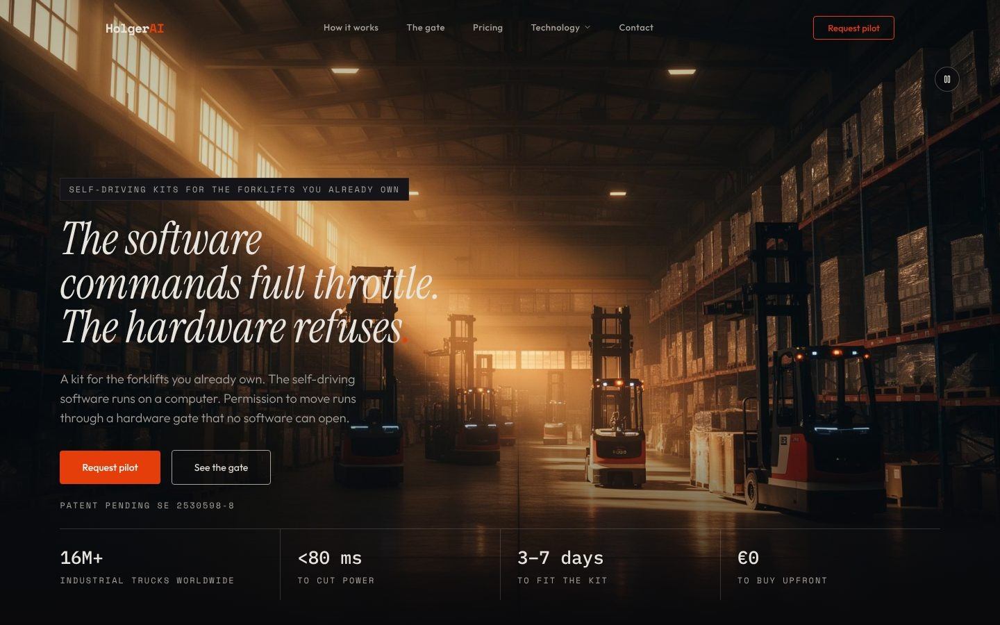
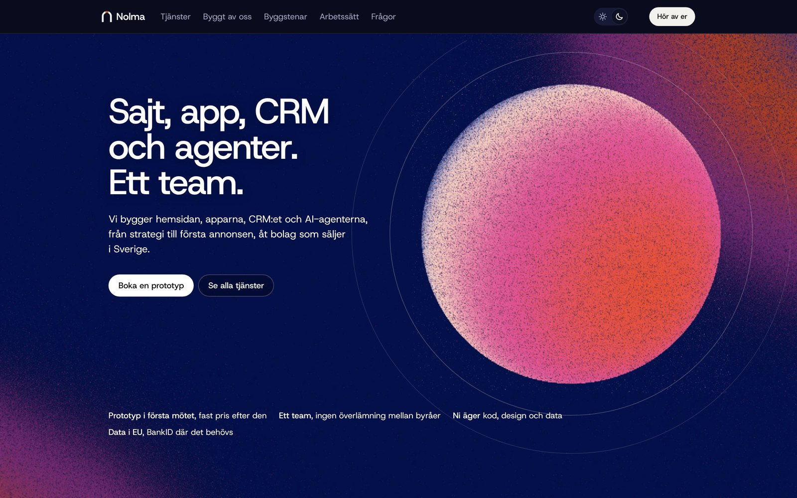

### Farre

Stockholm. I build AI agents, retrieval and data pipelines, and I measure them against fixed test sets before I trust them. Founder of [HolgerAI](https://holgerai.com) and [Nolma](https://nolma.se). Day job: team lead in GMP-regulated production of molecular diagnostic tests (ISO 13485, IVDR), so I am used to SOPs, deviations and audits.

---

#### HolgerAI · retrofit autonomy for forklifts

A Swedish deep tech company building a kit, with its own hardware, that makes the forklifts a warehouse already owns drive themselves. The software can ask for full throttle, but permission to move runs through a hardware gate that no software can open.

- Finalist, IFOY Award 2027, category IFOY Start-up of the Year
- Swedish patent application SE 2530598-8 (2025) and PCT application (2026)

#### Nolma · AI studio for Swedish companies

Builds the whole package for a company: website, app, a dashboard for the staff and AI agents that do the routine work, with a person approving before anything goes out. I designed and built the site.

---

#### Start here

| Repo | What it is | Measured |
| --- | --- | --- |
| [wattvik-signals](https://github.com/farrebutterfly-rgb/wattvik-signals) | Daily ingest of manufacturer PCN/EOL notices and distributor market letters, tagged and matched against a customer's BOM. Python, PostgreSQL, CI with Postgres as a service | 107 tests |
| [flight-time-check](https://github.com/farrebutterfly-rgb/flight-time-check) | Live test of a flight search app inside ChatGPT against the booking website. Found local times labelled as UTC, wrote the fix and tested the fix | 25 searches, before and after |
| [hub-minne](https://github.com/farrebutterfly-rgb/hub-minne) | Local RAG memory for an agent platform. Hybrid search (pgvector plus Postgres full text, Reciprocal Rank Fusion), citations, local model | Right fact in top 5: 45 % to 77 % |
| [svenska-pii](https://github.com/farrebutterfly-rgb/svenska-pii) | Swedish PII recognizers with check-digit validation: personnummer, samordningsnummer, organisationsnummer, bankgiro, IBAN. Optional Presidio integration | Benchmarked on Skatteverket test numbers |
| [agent-permit](https://github.com/farrebutterfly-rgb/agent-permit) | Human approval for one exact agent action: pre-tool hook, MCP server, approval from the phone, hash-chained audit log | Blocks by default when input cannot be parsed |

#### AI engineering exercises

Small, runnable projects. Each runs a demo with no API key, ships its own tests and says plainly what it does not prove yet.

| Repo | What it shows |
| --- | --- |
| [agent-evals](https://github.com/farrebutterfly-rgb/agent-evals) | 50 labelled cases, held-out split, regression check that fails on deliberately degraded systems |
| [grounded-context](https://github.com/farrebutterfly-rgb/grounded-context) | Retrieval with citations checked against source text; three context strategies under a token budget |
| [agent-toolkit](https://github.com/farrebutterfly-rgb/agent-toolkit) | Tool-calling agent with schema-validated tools, timeouts, step limit and a grounded final answer |
| [review-workflow](https://github.com/farrebutterfly-rgb/review-workflow) | Planner and worker extraction with a Python validator and human review. The single agent won under a tight budget, and the repo says so |
| [durable-jobs](https://github.com/farrebutterfly-rgb/durable-jobs) | Checkpointed jobs that survive SIGKILL, idempotent requests, bounded retries |
| [sandbox-runner](https://github.com/farrebutterfly-rgb/sandbox-runner) | Sandbox for model-written Python; 13 isolation controls verified with bubblewrap and unshare |
| [remember-me](https://github.com/farrebutterfly-rgb/remember-me) | User-owned memory with correction, deletion and backend-enforced access |
| [agent-api-sdk](https://github.com/farrebutterfly-rgb/agent-api-sdk) | React and TypeScript product with a documented API, typed SDK, auth and rate limits |

#### Products

- **[Relta](https://relta.app)** · AI accounting for Swedish companies, in pilot. Agents do the bookkeeping and an authorised accountant signs with BankID. Next.js, Neon, Stripe, BankID, bank connection, Peppol.
- **[Lexra](https://lexra.se)** · AI legal services. Contract review at 87 % recall and 100 % precision on a 136-question test set; a licensed lawyer signs.
- **[knuff](https://knuffjobb.se)** · job search service, built but not launched. Reads every Platsbanken ad through the JobTech APIs, scores ads against the user's CV and checks every claim in a cover letter against the CV.
- **[Wattvik](https://wattvik.com)** · component shortage monitoring for B2B buyers. Dormant since October 2026; the ingest is open as wattvik-signals above.

---

**Stack** · TypeScript, Node.js, Python, SQL, React, Next.js, PostgreSQL, pgvector, Supabase, Docker, GitHub Actions, LLM APIs, local models

**Languages** · Swedish and English (fluent), Tigrinya and Arabic (B2)
